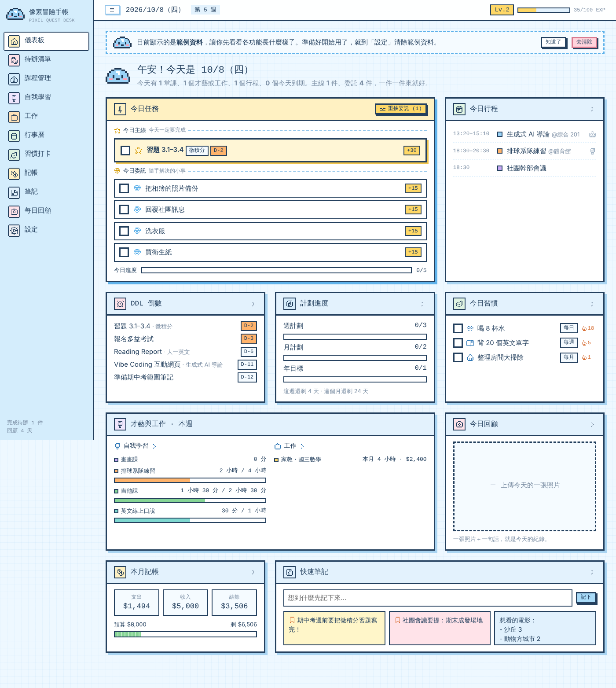

# 像素冒險手帳 Pixel Quest Desk

一個可愛像素風的個人工作台，把行程、待辦、課程、才藝、家教、習慣、記帳、筆記和每日回顧放在同一個地方。每天打開就能一眼看清楚今天、這週、這個月的狀態。

## 特色

- **今日主線＋今日委託**：像 RPG 接每日任務，今天到期的事一定是主線，未分類的小事隨機抽成委託，完成可以獲得經驗值升級
- **待辦清單**：四象限／時間欄位兩種檢視，拖曳就能分類，完成的事不會消失
- **課程管理**：自動排課表、作業 DDL、每週進度
- **自我學習**：才藝課、球隊練習、自學分開記錄，有每週目標時間
- **工作**：家教上課紀錄、時數與收入，入帳自動同步到記帳
- **習慣打卡**：每日／每週／每月／自訂頻率，結業的習慣會保留紀錄
- **記帳、筆記、行事曆、每日回顧（一天一張照片）**

## 使用方式

直接打開網頁就能用，資料存在自己的瀏覽器裡（可以在「設定」匯出／匯入備份）。

## 檔案

- `index.html`：整個網頁（HTML、CSS、JavaScript 都在這個檔案）
- `spec.md`：規格書與修改紀錄
- `versions/`：各版本截圖與第一版程式

像素圖示來自 [pixelarticons](https://github.com/halfmage/pixelarticons)（MIT License）。
